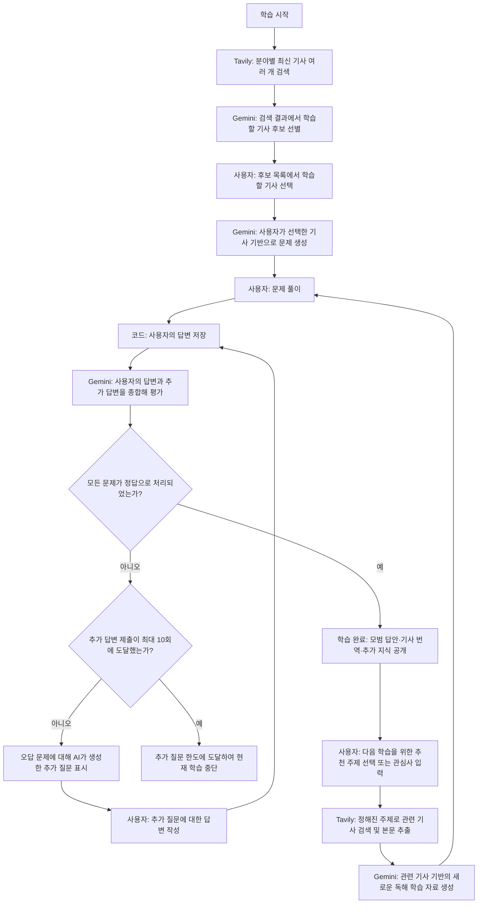

## 영어 독해 학습 에이전트 
Gemini로 실제 영어 뉴스 기사를 지문의 일부를 가져와 독해 문제를 내고, 사용자의 답변을 평가한 뒤 추가 질문으로 정답을 유도하는 Workflow 방식의 프로그램입니다.
사용자가 한 기사의 모든 문제를 해결하면, 해당 기사의 핵심 주제와 연관된 새로운 기사를 제시하여 학습을 이어갈 수 있게 합니다.

## 선정이유
영어 단어와 문법을 많이 알고 있더라도 실제 문장에서 해당 표현이 어떤 맥락과 의미로 사용되는지 이해하지 못하면 독해에 활용하기 어렵습니다. 
또 단어의 의미만 암기할 경우 실제 문맥에서 사용되는 뉘앙스나 의미를 잘못 이해할 수도 있습니다.

이에 실제 영어 뉴스 기사를 활용하여 다양한 문맥 속에서 영어를 반복적으로 접할 수 있는 프로그램을 만들어보았습니다. 
특히 하나의 주제와 연관된 여러 기사를 연속적으로 학습하도록 구성하여, 새로운 어휘와 표현을 다양한 맥락에서 접할 수 있도록 하는것을 목표로 했습니다.

## 왜 Workflow 인가
기존의 단순한 AI 대화 방식에는 몇 가지 문제가 있습니다.
```text
AI에게 기사를 요청하면 실제로 존재하지 않는 가짜 기사를 생성할 수 있다.
이전 학습 내용이나 사용자의 약점이 대화가 길어지면서 누락될 수 있다.
이전 대화에서 형성된 학습 맥락을 매번 다시 설명해야 한다.
이 모든걸 사용자가 요청하고자 하는 핵심을 매번 이전 대화에서 긁어모아 전달해줘야하는 불편함이 있다.
```

반면 장점에는..
```text
AI를 이용해 빠른 속도로 기사를 모을 수 있다.
기사를 요구에 맞게 적절하게 변형하여 문제로 만들 수 있다.
이런 부분은 AI를 사용하지 않는다면 하기 힘듦.
```

따라서 모든 것을 하나의 큰 프롬프트로 요청하는게 아니라 기사 찾기, 문제 생성부분은 AI를 통해서 하되, 가짜 기사 생성을 하는것과 AI가 이전 대화 맥락을 잊어버리는걸 방지해서 시스템에서 맥락을 저장하여 매번 요청에 맞게 핵심 정보를 같이 전달해주는 걸 Workflow 에서 하게 만들었습니다. 

## 실행 영상
https://drive.google.com/file/d/1a8M2N71i0j2yerIRLIYyldV5p83f6JS6/view

## 파일 구조
```text
Project
├── README.md 
├── static/
│   ├── app.js         
│   └── style.css
├── templates/
│   └── index.html
├── app_web.py               # Flask 구동.
├── gemini_api.py            # Gemini API 관련.
├── prompts.py               # Gemini API 에 사용되는 프롬프트.
├── reading_session.py       # 독해 문제, 사용자 답변, 평가 상태 및 추가 질문 이력 관리하는 클래스 모음.
├── reading_workflow.py      # 전체적인 학습 흐름 관리. 
└── tavily_api.py            # tavily API 관련.
```


## 간단한 실행도


# 전체 실행도



## 사용 기술
```text
Flask, Tavily API, Gemini API
HTML, CSS, JS
```

## AI 에게 도움 받은 내용 
``` text
- prompts.py에서 Gemini API에 전달할 프롬프트를 목적에 맞게 생성.
- Flask 와 프론트엔드 구현.
```

## 실행 방법
### 실행 환경
- Python 3.12
- Flask
- google-genai
- tavily-python

### 필요 환경변수
| 환경변수 | 설명 |
|---|---|
| `GEMINI_API_KEY` | Gemini API 키 |
| `TAVILY_API_KEY` | Tavily API 키 |
| `GEMINI_MODEL` | 사용할 Gemini 모델 이름 (기본값: `gemini-3.1-flash-lite`) |

### 실행 
1. 라이브러리 설치
```bash
pip install Flask google-genai tavily-python
```

2. Windows PowerShell
```powershell
$env:GEMINI_API_KEY="your_gemini_key"
$env:TAVILY_API_KEY="your_tavily_key"
$env:GEMINI_MODEL="gemini-3.1-flash-lite"

python app_web.py
```


